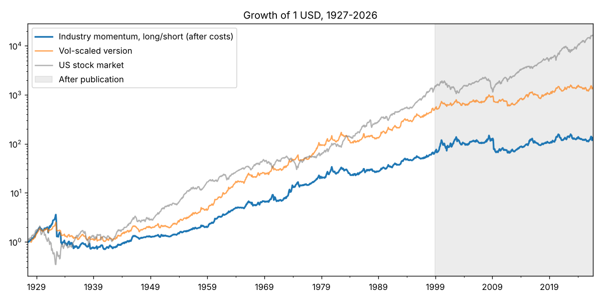
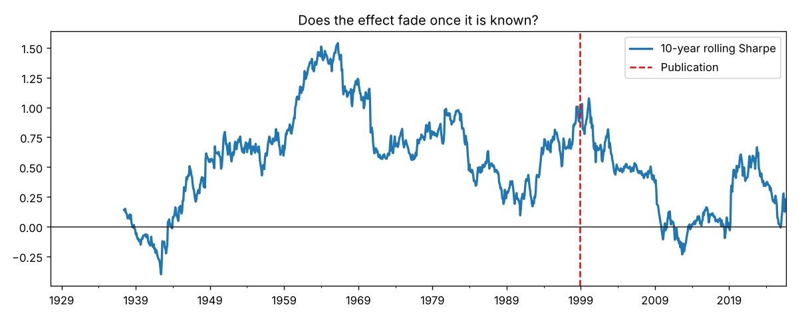
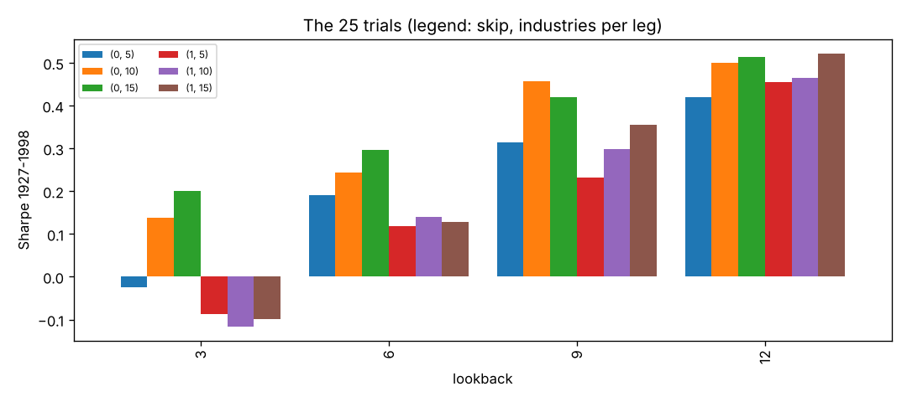
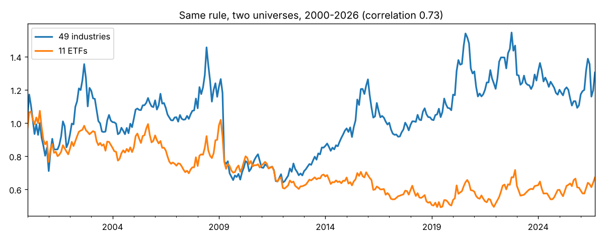
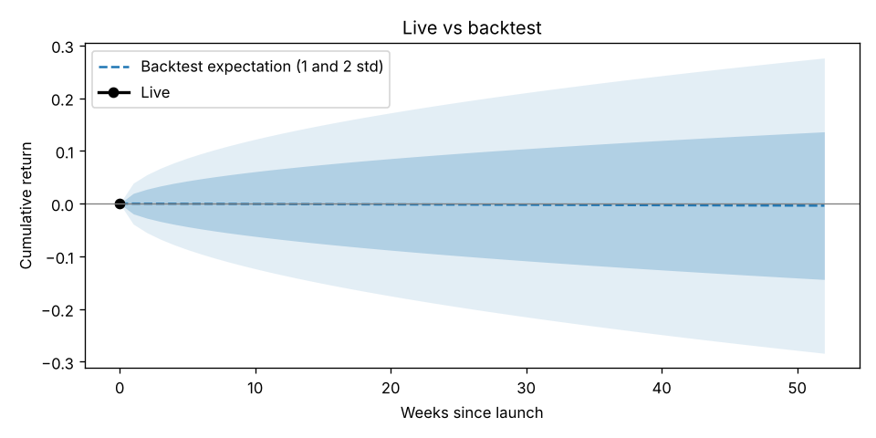

# Industry Momentum: 100-Year Backtest and Live Track Record

I test a classic hedge fund equity strategy: **buy the industries that have gone up the most
over the last year, sell short the ones that have gone down the most** (Moskowitz and
Grinblatt, 1999). The book is long/short, so it does not bet on the market going up. It
bets on the gap between winners and losers.

Three questions drive the project:
1. **Is the Sharpe real, or did I find it by luck?** I answer with the t-stat and the Deflated Sharpe Ratio, and I log every version I try.
2. **Does it still work now that everyone knows it?** I compare the years before and after the 1999 paper.
3. **Does it survive in real time?** From 27 November 2026, I run a 1 million USD paper book on the 11 sector ETFs and publish it every weekend ([LIVE.md](LIVE.md)).

| After costs | 1927-1998 (before the paper) | 1999-2026 (after the paper) | 1927-2026 |
|---|---|---|---|
| Return per year | 7.3% | 4.2% | 6.4% |
| Volatility | 15.6% | 18.3% | 16.4% |
| **Sharpe** | **0.46** | **0.23** | **0.39** |
| t-stat | 3.9 | 1.2 | 3.9 |
| Max drawdown | -80% | -56% | -80% |
| Skew | -2.8 | -0.9 | -2.1 |

## 1. The strategy

At the end of each month:
- **Signal**: the return of each of the 49 US industries from month t-11 to month t-1. I skip the last month, because over one month, prices tend to reverse.
- **Book**: long the 10 best industries, short the 10 worst, equal weights. 100% long and 100% short.
- **Timing**: the ranking at the end of month t is traded in month t+1. No look-ahead.
- **Costs**: 10 bp each time I buy or sell, plus 0.25% per year to borrow the shorts. The book trades 84% of its capital per month, so costs take 1.3% per year.

**Why should it work?** News about an industry (oil prices, interest rates, AI, a drug
approval) reaches prices slowly. Investors underreact, and then the trend lasts for months.
A short-term reversal sits on top of it, which is why I skip the most recent month.

## 2. Data

- **Backtest**: [Ken French Data Library](https://mba.tuck.dartmouth.edu/pages/faculty/ken.french/data_library.html), 49 value-weighted industry portfolios, July 1926 to September 2026, plus the Fama-French market and momentum factors. Free and public.
- **Live**: the 11 SPDR sector ETFs (XLK, XLF, XLE, XLV, XLI, XLY, XLP, XLU, XLB, XLRE, XLC), total return including dividends. Bloomberg photos every Friday. Free Yahoo prices for the history since 1999.
- **Check**: the Bloomberg total returns (Nov 2025 to Oct 2026) match Yahoo to within 0.01% per month.
- Raw Bloomberg data is not published (licence).

## 3. Backtest



- **The paper's period (1963-1995)**: I find a Sharpe of **0.64** (t = 3.6). The original result replicates.
- **1932**: the worst momentum crash. In June-August 1932, the market rebounds +82% from the bottom of the Depression. The losers rebound the most, and the short leg blows up: **-61% in three months**.
- **After 1999**: the Sharpe halves to 0.23 and is no longer significant (t = 1.2). The second big crash comes in March-May 2009 (**-40%**): banks and car makers, the losers of 2008, rebound the most.



The 10-year Sharpe peaks in the 1960s, stays positive most of the time, and drifts lower after
publication. This is what McLean and Pontiff (2016) find for 97 published anomalies: the
return falls by about half once the paper is out.

## 4. Is the Sharpe real?

| Measure | Question | Formula | My result |
|---|---|---|---|
| Sharpe | How much return per unit of risk? | mean / std × √12 | 0.46 (1927-1998) |
| t-stat | Could the true mean be zero? | Sharpe × √years | 3.9 |
| Deflated Sharpe | Same, knowing I tried 25 versions and the returns have fat tails | Bailey and Lopez de Prado (2014) | **0.61** |

**t-stat.** With 72 years of data, even a modest Sharpe of 0.46 gives t = 3.9, above the
bar of 3 that Harvey, Liu and Zhu (2016) ask for. Long history is the big advantage of the
Ken French data.

**Deflated Sharpe Ratio.** I try 25 versions on 1927-1998 only (lookback of 3, 6, 9 or 12
months; skip the last month or not; 5, 10 or 15 industries per leg; plus one vol-scaled
version). All of them are in [`results/trials_log.csv`](results/trials_log.csv). The best of
25 useless strategies would show a Sharpe of **0.43** by luck. My rule shows 0.46, which is
only slightly better. On top of that, the 1932 crash gives a skew of -2.8, and the DSR
penalises fat left tails. The result is a probability of **0.61** that the true Sharpe is
positive, far from the 0.95 target. **The plain rule does not pass.**



The trials tell a clear story. Longer lookbacks work better: 3 months is noise, and 12
months is the best. The number of industries matters little. I did not pick 12 months after
seeing this chart: it is the rule of the original paper.

**The fix I announced in advance: vol scaling.** Before running anything, I wrote in my
plan that I would test exactly one fix for the crashes (Barroso and Santa-Clara, 2015):
when the strategy has been volatile over the last 6 months, cut the position. Momentum
crashes come after volatile markets (1932, 2009), so this cuts the size before the crash.

| | Plain rule | Vol-scaled |
|---|---|---|
| Sharpe 1927-2026 | 0.39 | **0.57** |
| t-stat | 3.9 | **5.7** |
| Skew | -2.1 | -0.5 |
| Jun-Aug 1932 | -61% | -28% |
| Mar-May 2009 | -40% | -24% |
| **Deflated Sharpe (1927-1998)** | 0.61 | **0.97** |

The vol-scaled version passes the DSR test (0.97 > 0.95). It is counted among the 25 trials,
so the DSR already pays for it. The lesson: the edge of momentum is real, but most of the
risk sits in a few crashes, and the Sharpe only becomes convincing once the crashes are managed.

## 5. Is it a new alpha?

I regress the monthly P&L on the US market and on the Fama-French stock momentum factor (UMD),
with Newey-West t-stats:

| Regression | Alpha per year | t-stat | Beta market | Beta UMD | R² |
|---|---|---|---|---|---|
| Market only | **+8.1%** | 5.4 | -0.21 | | 5% |
| Market + stock momentum | +0.1% | 0.1 | 0.04 | 0.82 | 63% |

Against the market alone, the alpha is large. Once I add stock momentum, it disappears:
industry momentum and stock momentum are largely the same trade. A hedge fund that already
runs stock momentum would get little from this book. A fund that has none gets a cheap version
with 49 portfolios instead of 3,000 stocks.

## 6. From 49 industries to 11 ETFs

The Ken French data comes out with a one-month delay, so I cannot trade it live. In real time
I use the 11 SPDR sector ETFs: long the 3 best, short the 3 worst, same signal.



| 2000-2026, same rule | 49 industries | 11 sector ETFs |
|---|---|---|
| Sharpe | 0.15 | **-0.03** |
| t-stat | 0.8 | -0.1 |
| Max drawdown | -56% | -54% |
| Correlation | 0.73 | |

The two books move together (correlation 0.73), but the ETF version earns nothing since 2000.
Eleven broad sectors have much less dispersion than 49 narrow industries: "Technology" mixes
software, chips and hardware, which trend in different directions. **I expect a Sharpe close
to zero for the live book.** I run it anyway: a live record that matches a sober forecast is
worth more than a backtest that promises too much.

## 7. Live track record

The rules are frozen in [RULES.md](RULES.md). The signal skips the most recent month, so
the positions for the next rebalance are known a full month in advance. I publish them on
GitHub **a month before I trade them**. The commit time stamp proves they were chosen
before the market moved. Every Friday I take the Bloomberg prices. Over the weekend I compute
the P&L. Before Monday 9:00 Paris time I commit. At each rebalance, I add a short letter to
investors.

| Since launch (27 Nov 2026) | |
|---|---|
| Weeks | 0 |
| Cumulative P&L | - |
| NAV (start 1,000,000 USD) | - |
| Worst week | - |

**First positions** (traded at the close of Friday 27 November 2026): long Energy (XLE),
Technology (XLK), Materials (XLB); short Utilities (XLU), Consumer Discretionary (XLY),
Communication (XLC).



The cone shows what the ETF backtest expects over the first year (mean, 1 and 2 standard
deviations). The live point starts at 0 and one point is added every week. After a few weeks
a t-stat means nothing. The real question is whether the live P&L stays inside the cone.

**Latest week and full history:** [LIVE.md](LIVE.md).

## How to run

```
pip install -r requirements.txt
python scripts/download_etfs.py   # once: ETF prices from Yahoo
python backtest.py                # backtest, statistics and charts in results/
python live.py positions          # after the last Friday of the month: next positions
python live.py week               # every weekend: P&L of the week
```

References: Moskowitz and Grinblatt (1999), *Do Industries Explain Momentum?* Jegadeesh and
Titman (1993). Barroso and Santa-Clara (2015), *Momentum Has Its Moments*. Daniel and
Moskowitz (2016), *Momentum Crashes*. Bailey and Lopez de Prado (2014), *The Deflated Sharpe
Ratio*. Harvey, Liu and Zhu (2016). McLean and Pontiff (2016), *Does Academic Research
Destroy Stock Return Predictability?*
